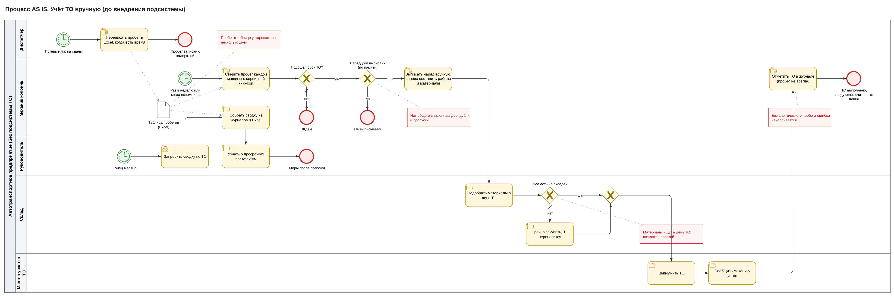
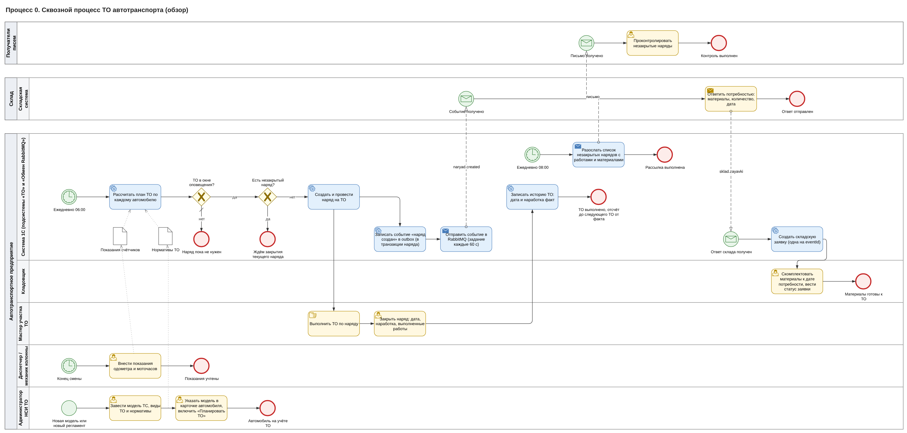
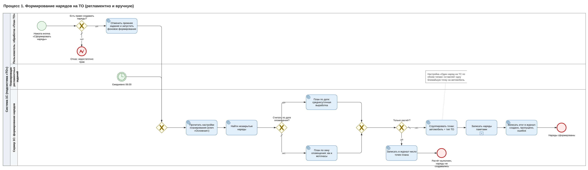
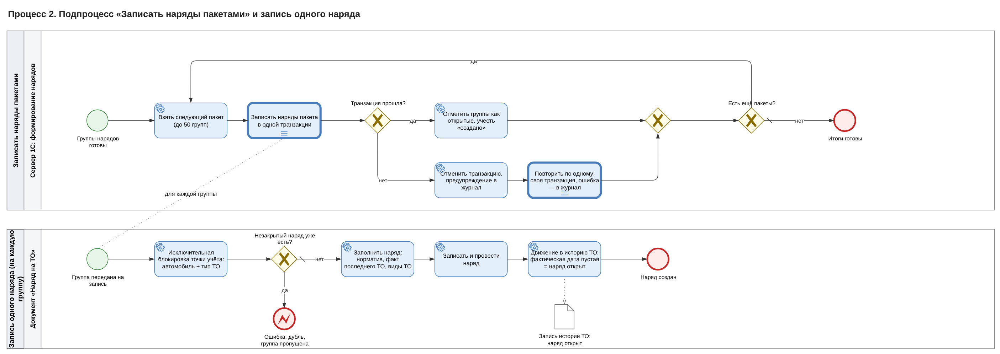
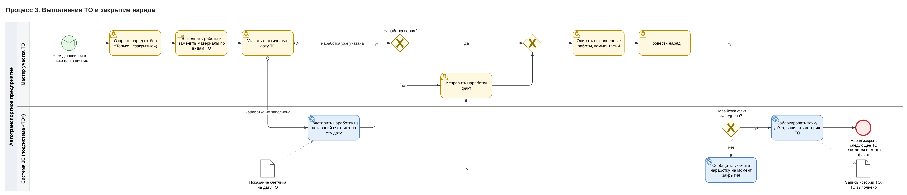
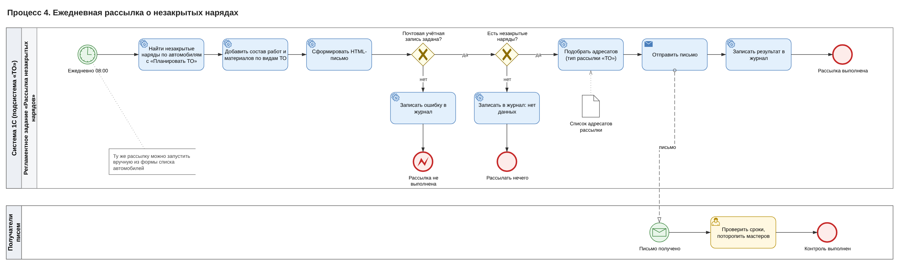

# Подсистема «ТО»: спецификация на разработку

10.11.2026

## 1. Общие сведения

| Параметр | Значение |
| --- | --- |
| Тема курсового проекта | «Формирование нарядов на ТО (расчёт материалов)» |
| Наименование разработки | Подсистема «Техническое обслуживание автотранспорта» (ТО) |
| Конфигурация | демо-конфигурация 1С:Предприятие 8.3, доработка в основной конфигурации |
| Контекст | курсовой проект курса «Архитектор 1С» |
| Подсистемы и префиксы | `ТО_` — Техническое обслуживание; `ОП_` — Оценка производительности; `RMQ_` — Обмен RabbitMQ |
| Тесты | расширение `YAXUNIT` (движок YAxUnit), сценарии Vanessa Automation |
| Версия, разработчик, запросы на изменение | заполняются по факту |

**Термины**

| Термин | Значение |
| --- | --- |
| ТО по пробегу / по наработке | обслуживание через заданное число километров (одометр) или моточасов (спецтехника, погрузчики) |
| Модель ТС | регламент ТО для одинаковых машин: какие виды ТО и с каким нормативом |
| Вид ТО | конкретное обслуживание (ТО-1, ТО-2, замена фильтров) со списком работ и материалов |
| Норматив | через сколько километров или моточасов повторяется вид ТО; у единичного вида ТО не повторяется |
| Окно оповещения | запас до ТО, с которого создаётся наряд: по умолчанию 1 000 км или 32 моточаса, для модели можно задать своё |
| Показания счётчиков | полные цифры одометра и счётчика моточасов на дату, не пробег за смену |
| Наряд на ТО | задание на обслуживание одной машины по одному типу ТО со всеми видами ТО, которые пора сделать; незакрытый — без фактической даты ТО |
| Складская заявка / дата потребности | запрос складу на материалы по одному наряду; дата, к которой материалы нужны на участке |
| Ключевая операция, APDEX | операция с целевым временем T, длительность которой замеряется; индекс удовлетворённости (S + R/2) / N |
| Outbox / inbox | исходящие и входящие сообщения брокера, сначала сохраняемые в базе 1С |

## 2. Постановка задачи

### 2.1. Бизнес-задача

Нужно следить за сроками техобслуживания каждой машины и заранее создавать наряд, чтобы ТО не пропускали и не делали с опозданием, а склад успевал подготовить материалы. У каждой модели свой регламент: одно ТО каждые 15 000 км, другое — каждые 30 000, у спецтехники — по моточасам. Пропущенное ТО оборачивается поломкой на линии и простоем, слишком раннее — лишними расходами на масло, фильтры и работу.

### 2.2. Текущий процесс (as is)

1. Диспетчер записывает пробег из путевых листов в Excel или журнал, нерегулярно.
2. Механик сравнивает пробег с регламентом по сервисной книжке или по памяти.
3. Наряд оформляется вручную, состав работ и материалов составляют каждый раз заново.
4. Мастер выполняет ТО; пробег на момент ТО записывают не всегда.
5. Руководитель узнаёт о просрочках из ручной сводки или после поломки.

**Узкие места**

- Сроки пропускают, стоит механику уйти в отпуск или парку вырасти.
- Одну машину могут дважды поставить на ТО, а другую забыть.
- Следующее ТО отсчитывают от планового, а не фактического пробега — ошибка накапливается.
- Склад узнаёт о нужных материалах только в день ТО.
- История ТО разбросана по файлам и тетрадям.

На схеме as is (BPMN 2.0) все шаги выполняют люди, узкие места отмечены красными выносками.



### 2.3. Цели и ожидаемый результат

Люди вносят в систему только два факта — показания счётчиков и отметку о выполненном ТО. Расчёт сроков, наряды, напоминания и заявка складу выполняются автоматически.

Цикл ТО остаётся прежним, но три шага из пяти — расчёт срока, оформление наряда и контроль — переходят от людей к системе.

> Схема «as is и to be: пять шагов цикла ТО» — интерактивная диаграмма в онлайн-версии документа.

| Что меняется | As is | To be |
| --- | --- | --- |
| Учёт пробега | Excel или журнал, нерегулярно | документ «Учёт наработки» каждую смену |
| Расчёт срока ТО | механик вручную | система каждое утро по регламенту модели |
| Оформление наряда | вручную | автоматически, с работами и материалами |
| Защита от дублей | нет | второй открытый наряд того же типа не создаётся |
| Точка отсчёта следующего ТО | часто плановый пробег | фактический пробег закрытого наряда |
| Контроль руководителя | ручная сводка | письмо каждый день в 08:00 |
| Подготовка склада | в день ТО | заранее: событие через RabbitMQ и складская заявка с датой потребности |
| История ТО | разбросана по файлам | в одном месте по каждой машине |
| Скорость ключевых операций | не измеряется | замеры и отчёт APDEX |

## 3. Функциональные требования

### 3.1. Участники

| Роль | Что делает | Как часто |
| --- | --- | --- |
| Администратор справочников | заводит модели и регламенты, работы и материалы, получателей писем; в карточке машины указывает модель и ставит флажок «Планировать ТО» | при покупке машины или смене регламента |
| Диспетчер или механик колонны | вносит показания, смотрит план ТО, при необходимости формирует наряды вне графика | ежедневно |
| Мастер участка ТО | выполняет ТО и закрывает наряд: дата, фактический пробег, выполненные работы | по мере появления нарядов |
| Руководитель службы эксплуатации | получает утреннее письмо, следит, чтобы наряды не зависали; смотрит APDEX | ежедневно |
| Кладовщик | получает складскую заявку, собирает материалы к дате потребности, отмечает выдачу и статус | по мере появления заявок |
| Администратор системы | настраивает подключение к RabbitMQ, подписки и ключевые операции, разбирает ошибки обмена | по событию |
| Система 1С | считает план, создаёт наряды, рассылает письма, обменивается со складом, замеряет операции | по расписанию |

Один человек может совмещать несколько ролей.

### 3.2. Процесс (to be)

1. **Конец смены.** Диспетчер вносит показания одометра и моточасов в документ «Учёт наработки».
2. **06:00.** Система по каждой машине с флажком «Планировать ТО» берёт последние показания, последнее выполненное ТО и регламент модели. Если до ТО меньше окна оповещения, а открытого наряда нет, создаётся наряд с видами ТО, работами и материалами.
3. **Сразу после наряда.** Система публикует для склада событие «наряд создан»; по ответному сообщению склада создаётся складская заявка с материалами, количеством и датой потребности.
4. **08:00.** Руководитель, мастера и склад получают письмо со списком незакрытых нарядов.
5. **В течение смены.** Мастер выполняет ТО и закрывает наряд: система подставляет пробег по последним показаниям, мастер проверяет и описывает сделанное.
6. **Факт сохранён.** Следующее ТО отсчитывается от фактического пробега закрытого наряда.

Если наряд нужен срочно, диспетчер запускает формирование вручную кнопкой «Сформировать наряды на ТО» в списке автомобилей или из формы «План ТО»; повторная рассылка — кнопкой «Разослать наряды на ТО».

На сквозной схеме виден весь цикл: расчёт в 06:00 опирается на показания и регламент, наряд уходит мастеру, а закрытый наряд становится точкой отсчёта для следующего ТО.



Обозначения на схемах BPMN: жёлтые задачи выполняют люди, голубые — система. Зелёный круг — начало процесса (с часами — по расписанию, с конвертом — по полученному сообщению), красный — завершение, ромб с крестом — выбор одного из путей, лист с загнутым углом (объект данных) — данные, которые задача читает или записывает (запись регистра, сообщение обмена), пунктир с конвертом — письмо.

### 3.3. Требования и бизнес-правила

| № | Требование |
| --- | --- |
| ФТ1 | Регламент ТО задаётся на модель ТС: виды ТО, тип счётчика, норматив; для вида ТО — работы и материалы. В плане участвуют только машины с флажком «Планировать ТО». |
| ФТ2 | Показания вводятся полными цифрами счётчика; не могут быть отрицательными и меньше предыдущих. |
| ФТ3 | История ТО до внедрения вводится документом «Ввод остатков». |
| ФТ4 | Следующий порог вида ТО = пробег последнего закрытого ТО этого вида + норматив. При совпадении порогов старший вид поглощает младший; единичный вид ТО после выполнения не повторяется. |
| ФТ5 | Окно оповещения по умолчанию 1 000 км или 32 моточаса, настраивается для модели. |
| ФТ6 | План ТО показывается со статусами «просрочено», «в окне», «запланировано» и прогнозом даты по среднесуточной выработке. |
| ФТ7 | Наряды формируются ежедневно в 06:00 и вручную; на машину и тип ТО — не более одного незакрытого наряда, и автоматически, и вручную. |
| ФТ8 | Наряд не закрывается без фактической даты и пробега; закрытый наряд становится точкой отсчёта. |
| ФТ9 | Ежедневно в 08:00 получатели получают письмо с незакрытыми нарядами, работами и материалами. |
| ФТ10 | При первом проведении наряда с материалами склад получает событие «наряд создан» через RabbitMQ. |
| ФТ11 | По сообщению склада складская заявка создаётся ровно один раз. Дата потребности — плановая дата ТО по среднесуточному пробегу; если её нельзя посчитать, дата наряда плюс 7 дней. Дата не раньше текущей. Статусы заявки (новая, в работе, исполнена, отклонена, отменена) хранятся с историей. |
| ФТ12 | Длительность шести ключевых операций замеряется; по замерам строится отчёт APDEX. |
| ФТ13 | Потребность наряда в материалах считается по нормам видов ТО наряда: одна строка на пару «вид ТО + позиция», количества суммируются, позицию без номенклатуры задаёт текст содержания. Та же потребность уходит в событие «наряд создан» и в складскую заявку, созданную вручную из наряда. Наряд без материалов события не порождает. |

## 4. Технические особенности реализации

### 4.1. Общие данные по реализации

Версия, разработчик и запросы на изменение заполняются по факту. Перечень объектов — в разделе 5 (Таблица 10).

### 4.2.1. Легенда и контекст решения

**Бизнес-задача.** Снять с людей расчёт сроков ТО, оформление нарядов, контроль и передачу потребности складу (раздел 2).

**Предметные понятия.** Модель с регламентом, вид ТО с работами и материалами, показания счётчиков, наряд, складская заявка (раздел 1).

**Основа реализации.** Три подсистемы основной конфигурации: прикладная ТО и две инфраструктурные — ОП (замеры и APDEX) и RMQ (обмен через RabbitMQ). ТО пользуется ОП и RMQ через их программный интерфейс; ОП и RMQ о ТО не знают.

**Рабочий цикл.**

1. Ввод показаний → регистр показаний.
2. 06:00 — расчёт плана и создание нарядов.
3. Первое проведение наряда → сообщение в outbox в той же транзакции.
4. Раз в 60 с — отправка outbox и чтение inbox; входящее сообщение склада → складская заявка.
5. 08:00 — рассылка незакрытых нарядов.
6. Закрытие наряда → новая точка отсчёта.

**Расширяемость.** Новая ключевая операция добавляется строкой в описание операций и вызовом замера; новое входящее сообщение — обработчиком в переопределяемом модуле RMQ и записью в справочнике подписок. Код ОП и RMQ при этом не меняется.

### 4.2.2. Ключевые проектные решения

| Решение | Обоснование |
| --- | --- |
| Три подсистемы с односторонними зависимостями и переопределяемыми модулями (как в БСП) | ОП и RMQ переносятся в другие конфигурации без изменений |
| Расчёт плана — чистые функции в отдельном модуле | логика тестируется без базы, один расчёт для задания и формы плана |
| Регистр `ТО_Проведение` как точка учёта и блокировки | один ключ «ТС + тип ТО» даёт и последнее ТО, и защиту от двух открытых нарядов |
| Transactional outbox + inbox | недоступный брокер не мешает проведению; сообщения не теряются и не дублируют заявки |
| Компонента PinkRabbitMQ в общем макете | не нужна установка на сервер отдельно от конфигурации |
| Повышение прав только в узких привилегированных методах | роли ТО не нужны права на объекты ОП и RMQ |
| Пароль брокера — в отдельном регистре без прав у ролей | пароль не читается из формы и отчётов |
| Клиентский замер проведения в форме | измеряется время, которое видит пользователь |
| Тесты в расширении YAxUnit | тестовый код не попадает в поставку |

### 4.2.3. Способ реализации

- **Реализовать** объекты в основной конфигурации с префиксами `ТО_`, `ОП_`, `RMQ_` и включить каждый в свою подсистему.
- **Разделить** модули по контексту: `…Клиент`, `…ВызовСервера`, серверные, `…ПолныеПрава` (привилегированный), `…Переопределяемый`. Включить внешнее соединение у серверных модулей RMQ.
- **Вынести** расчёт плана в `ТО_Планирование` (без запросов и записи), запросы и запись — в `ТО_Сервер`.
- **Не ссылаться** из ОП и RMQ на объекты ТО; связь — только через переопределяемые модули.
- **Не изменять** типовые объекты демо-конфигурации.
- **Не давать** ролям прав на регистр паролей подключений.
- **Разместить** тесты в расширении `YAXUNIT`, в конфигурации тестового кода не оставлять.

> Схема «Архитектура: три подсистемы и внешний брокер» — интерактивная диаграмма в онлайн-версии документа. Диаграммы C4 — в `doc/diagrams/1_C4/`.

Сплошные стрелки — вызовы программного интерфейса; с брокером работает только RMQ.

### 4.2.4. Состав работ

| Блок | Что сделать |
| --- | --- |
| НСИ ТО | создать справочники ТС, моделей (с табличной частью регламента), видов ТО, работ, МПЗ; перечисления типов |
| Учёт | создать документы учёта наработки, ввода остатков, нарядов, складских заявок; регистры показаний, проведения, статусов и настроек |
| Логика ТО | модули `ТО_Сервер`, `ТО_Планирование`, `ТО_СкладскиеЗаявки`, `ТО_Интеграция`, `ТО_ВызовСервера`; форма «План ТО»; два регламентных задания; кнопки в списке автомобилей |
| Отчётность и печать | отчёт «Проведённые ТО» на СКД; печатные формы четырёх документов (макеты, команды в группе «Печать», модуль `ТО_Печать`); общая команда и форма «Движения документа» |
| ОП | справочник ключевых операций, регистр замеров, константа, отчёт APDEX на СКД, четыре общих модуля, роль |
| RMQ | справочники подключений, сообщений и подписок, регистр паролей, перечисления статусов, константы, шесть общих модулей, макет компоненты, форма настроек, консоль, два задания, роль |
| Тесты | 20 модулей YAxUnit в расширении `YAXUNIT` (13 с тестами, 7 с тестовыми данными), сценарии Vanessa Automation, обработка заполнения тестового парка |

### 4.2.5. Алгоритмы

**Расчёт плана ТО**

1. Одним пакетом запросов собрать временные таблицы: `ВТ_Показания` (срез последних), `ВТ_Пробеги` (показания на начало и конец периода среднесуточной выработки), `ВТ_Наработка` (последнее закрытое ТО каждого вида), регламент моделей и открытые наряды. Срезы — через временные таблицы, без запросов в цикле.
2. Отбор по ТС не записывать через «ИЛИ»: подставлять вместо маркера либо `Поле В (&ТСОтбор)`, либо `ИСТИНА` (`УстановитьУсловиеОтбораПоТС`).
3. Построить порядок видов ТО модели; при совпадении порогов оставить старший вид.
4. Порог = пробег последнего закрытого ТО вида + норматив; если ТО вида не было — от нуля.
5. Среднесуточная выработка = (показание на конец − на начало) / число дней; дата ТО = дата последнего показания + остаток до порога / выработка. При нулевой выработке дату не строить.
6. Назначить статус: порог пройден — «просрочено»; до порога меньше окна — «в окне»; иначе «запланировано». Оставить одну ближайшую точку на ТС и тип ТО.

**Формирование нарядов** (задание 06:00 и ручной запуск)

1. Начать замер «ФормированиеНарядов»; при ручном запуске проверить права.
2. Рассчитать план по машинам с флажком «Планировать ТО», оставить точки «просрочено» и «в окне».
3. Сгруппировать точки в наряды по ТС и типу ТО.
4. Записывать пакетами по 50 нарядов в транзакции; для каждого — исключительная управляемая блокировка `ТО_Проведение` по ТС и типу ТО, повторная проверка открытого наряда, запись и проведение с работами и материалами.
5. При сбое пакета повторить его по одному наряду; ошибку по ТС записать в журнал и перейти к следующей.
6. Закончить замер с объёмом = число нарядов, в том числе при ошибке.





**Проведение документов**

| Документ | Проверить | Движения |
| --- | --- | --- |
| ТО\_УчетНаработки | показание ≥ 0 и не меньше предыдущего; строки не дублируются | `ТО_ПоказанияСчетчиков` |
| ТО\_ВводОстатков | заполнены ТС, вид ТО, дата, показание | `ТО_Проведение`, `ТО_ПоказанияСчетчиков` |
| ТО\_Наряды | нет другого открытого наряда на ТС и тип ТО (под блокировкой); при закрытии заполнены дата и показание | `ТО_Проведение`; при закрытии — `ТО_ПоказанияСчетчиков` |

В `ПередЗаписью` наряда вычислить признак «проводится впервые» (режим — проведение, фактическая дата пуста, в базе не проведён); в `ПриЗаписи` по нему вызвать `ТО_Интеграция.ЗарегистрироватьНарядСоздан`.



**Рассылка** (задание 08:00). Одним запросом выбрать незакрытые наряды с работами и материалами, сформировать одно письмо на получателя из `ТО_ПолучателиУведомлений`. Нет настроенной почты или нет нарядов — записать в журнал и завершить. Замер «РассылкаНарядов», объём — число писем.



**Расчёт материалов** (`ТО_СкладскиеЗаявки.ДанныеЗаявкиПоНаряду`; вызывается при регистрации события `naryad.created` и командой «Создать складскую заявку» в форме наряда)

1. Одним запросом соединить табличную часть «Виды ТО» наряда с табличной частью «Материалы» справочника `ТО_ВидыТО`: материал, содержание, количество на одно ТО. Порядок — по строкам видов ТО и материалов.
2. Пропустить строки без материала и без содержания. Строку без материала, но с содержанием оставить: позицию задаёт текст.
3. Сгруппировать по ключу «вид ТО + позиция» (`КлючПозиции`: УИД материала или содержание в нижнем регистре без пробелов по краям). Количества суммировать, разные тексты содержания объединить через «; ».
4. Дату потребности рассчитать в `ПлановаяДатаПотребности`: среднесуточная выработка — по последнему закрытому ТО того же типа и текущим показаниям (функции `ТО_Планирование`), остаток — норматив наряда минус текущие показания. Нет данных или дату не построить — дата наряда плюс 7 дней. Результат не раньше текущей даты.
5. Вернуть данные для `СоздатьИзДанных`: идентификатор запроса, УИД наряда и автомобиля, дату потребности, материалы. Если материалов нет, событие не регистрируется, а команда в форме сообщает «В видах ТО наряда не заданы материалы».

**Отчёт «Проведённые ТО»** (`ТО_ПроведенныеТО`, СКД)

1. Источник — регистр `ТО_Проведение`: активные записи с заполненной `ФактДатаТО` в пределах периода отчёта. Левым соединением добавить вид ТО из табличной части «Виды ТО» наряда-регистратора.
2. Поля: дата ТО, автомобиль, модель, тип ТО, наработка по плану (`НаработкаНорматив`), наработка факт, отклонение «факт − план», документ, вид ТО. Ресурс — количество различных документов.
3. Вариант «Основной»: группировка по автомобилю, внутри — по ТО (дата, документ, тип ТО, план, факт, отклонение) с сортировкой по дате, детальные записи — виды ТО. Параметр «Период» по умолчанию — текущий год; быстрые отборы по автомобилю и типу ТО.

**Печатные формы**

1. В каждый документ ТО добавить макет табличного документа `ПФ_<Документ>` и команду `Печать<Документа>` в группе `CommandGroup.Печать` с режимом параметра «Множественный».
2. Команда вызывает серверную функцию модуля `ТО_Печать` и показывает результат. В модуле прочитать данные всех выбранных документов одним пакетом запросов, каждый документ вывести с новой страницы.
3. Потребность в материалах наряда получать из `ДанныеЗаявкиПоНаряду`, а не из отдельного запроса: печатная форма и складская заявка должны совпадать.
4. Пустую табличную часть выводить строкой «нет строк», а не пустой таблицей.

**Движения документа**

1. Создать общую команду `ТО_ДвиженияДокумента` (тип параметра — ссылки на четыре документа ТО, группа — важные команды формы) и общую форму с полем табличного документа.
2. Список регистров собирать по метаданным: регистры из свойства «Движения» документа с отбором по регистратору и независимые регистры сведений, в типе измерения которых есть тип документа.
3. Для каждого регистра проверить право чтения, выполнить запрос с отбором по документу, вывести заголовок с числом записей, шапку и строки. Колонки — период, вид движения, измерения, ресурсы, реквизиты; для ссылок заполнить расшифровку.

### 4.2.6. Протокол обмена со складом

| Направление | Точка обмена / очередь | Ключ | Содержание |
| --- | --- | --- | --- |
| ТО → склад | exchange `to.events` | `naryad.created` | событие «наряд создан» |
| склад → ТО | queue `sklad.zayavki` | — | потребность для складской заявки, обработчик «ТО.СкладскаяЗаявка» |

Тело — JSON в UTF-8, `message-id` = `eventId` (реквизит наряда «ИдентификаторЗапроса»). Наряд без материалов событие не порождает.

```json
{
  "event": "naryad.created",
  "eventId": "<идентификатор запроса>",
  "occurredAt": "2026-11-07T06:00:12",
  "naryad":  { "id": "<уид>", "number": "<номер>", "date": "2026-11-07T06:00:10" },
  "vehicle": { "id": "<уид>", "name": "<наименование ТС>" },
  "needDate": "2026-11-14",
  "materials": [
    { "id": "<уид МПЗ>", "content": "<наименование>", "quantity": 24, "maintenanceKindId": "<уид вида ТО>" }
  ]
}
```

**Отправка (outbox)**

1. В `ЗарегистрироватьНарядСоздан` выйти, если обмен выключен или нет материалов; иначе вызвать `RMQ_Обмен.ЗарегистрироватьСообщение` — элемент `RMQ_ИсходящиеСообщения` со статусом «Новое» в текущей транзакции.
2. Задание раз в 60 с берёт пакет «Новое» и «Ошибка», группирует по подключению, публикует с подтверждением брокера и ставит «Отправлено».
3. При ошибке — «Ошибка» и +1 попытка; после предела — «НеВыгружается», дальше вручную из консоли.

**Получение (inbox)**

1. Задание раз в 60 с читает пакет из каждой активной подписки.
2. Сообщение с известным `message-id` не записывать повторно; новое записать в `RMQ_ВходящиеСообщения` («Новое»).
3. Подтверждение (ack) отправлять брокеру только после записи в базу.
4. Обработка: `RMQ_Получение.ОбработатьВходящее` → `RMQ_ОбменПереопределяемый.ПриОбработкеСообщения` → `ТО_Интеграция.ПриОбработкеСообщенияRMQ` → `ТО_СкладскиеЗаявки.СоздатьИзДанных(…, "RabbitMQ")`.
5. Успех → «Загружено»; исключение → «Ошибка» с текстом в сообщении и в журнале.

### 4.2.7. Оценка производительности (APDEX)

| Ключевая операция | Где замерять | Объём | T, с |
| --- | --- | --- | --- |
| ФормированиеНарядов | сервер, задание | число нарядов | 30 |
| РассылкаНарядов | сервер, задание | число писем | 5 |
| ПроведениеНаряда | клиент, форма наряда | 1 | 1 |
| ПроведениеУчетаНаработки | клиент, форма учёта | число строк | 2 |
| РасчетПланаПоТС | клиент, команда «Рассчитать» | число ТС | 1 |
| СозданиеСкладскойЗаявки | сервер, `СоздатьИзДанных` | 1 | 1 |

- Список операций задать в `ТО_Сервер.ПриОпределенииКлючевыхОпераций` (вызов из переопределяемого модуля ОП). Элемент справочника создавать при первом замере; T ≤ 0 в описании заменять на 1 с.
- Серверный замер: `НачатьЗамер` / `ЗакончитьЗамер`, прикладной код — в `Попытка`. Клиентский: старт в `ПередЗаписью`, окончание в `ПослеЗаписи` формы.
- Записывать замер в привилегированном режиме с восстановлением исходного; ошибку записи перехватывать и писать в журнал как предупреждение. Уникальность записи — измерение `Идентификатор`.
- APDEX = (S + R/2) / N: S — замеры не дольше T, R — от T до 4T, N — все. Отчёт `ОП_APDEX` (СКД) показывает также секунды на единицу объёма и детализацию до замера.

### 4.2.8. Обработка ошибок и журнал

| Событие журнала | Уровень | Когда |
| --- | --- | --- |
| ТО.ФормированиеНарядов | Ошибка | наряд по ТС не создан |
| ТО.РассылкаНарядов | Ошибка | письмо не отправлено |
| Оценка производительности | Предупреждение | замер не записан |
| Обмен RabbitMQ.Отправка / Получение | Ошибка | нет связи, ошибка публикации или обработки |

Ошибка замера или обмена не должна отменять прикладную операцию. Складская заявка создаётся в транзакции: при ошибке — откат, замер пишется после отката.

### 4.2.9. Идемпотентность и повторный запуск

- Повторное формирование не создаёт второй наряд: проверка открытого наряда под блокировкой + контроль при проведении.
- Событие складу регистрируется только при первом проведении наряда.
- Входящее с известным `message-id` не записывается; заявка с тем же `eventId` не создаётся повторно.
- Ключевая операция с тем же именем не создаётся дважды (проверка под блокировкой).

### 4.2.10. Производительность и блокировки

Расчёт плана — один пакет запросов и расчёт в памяти; запись нарядов — пакетами по 50; обмен — пакетами в фоновых заданиях, не в транзакции наряда. Управляемые блокировки: `ТО_Проведение` по ТС и типу ТО; справочник ключевых операций — при создании.

### 4.2.11. Роли и права

| Роль | Права |
| --- | --- |
| ТО | объекты ТО: чтение, запись, проведение; форма плана; отчёт «Проведённые ТО», печать, движения документа. На объекты ОП и RMQ прав нет |
| ТО\_Просмотр | просмотр объектов ТО; отчёт «Проведённые ТО», печать, движения документа |
| Администратор | справочники и настройки ТО |
| ОП\_ОценкаПроизводительности | ключевые операции, замеры (чтение), отчёт APDEX, константа отключения |
| RMQ\_АдминистраторОбмена | подключения, подписки, сообщения, настройки, консоль |

Привилегированные операции — только `RMQ_ОбменПолныеПрава` и запись замера ОП. Пароль брокера: форма показывает «\*\*\*\*\*\*\*\*», новый пароль записывается только при изменении.

### 4.2.12. Регламентные задания и интерфейс

| Задание | Расписание |
| --- | --- |
| ТО\_ФормированиеНарядов | ежедневно 06:00 |
| ТО\_РассылкаНарядов | ежедневно 08:00 |
| RMQ\_ОтправкаСообщений / RMQ\_ПолучениеСообщений | каждые 60 с; ничего не делают при выключенном обмене |

Интерфейс: раздел «Техническое обслуживание» (наряды, учёт наработки, план ТО, складские заявки, НСИ); в списке автомобилей — кнопки «Сформировать наряды на ТО» и «Разослать наряды на ТО»; форма «План ТО» с отбором по ТС и цветом статуса; отчёт «Проведённые ТО»; в формах документов — кнопка «Печать» и команда «Движения документа». В администрировании — «Оценка производительности» и «Обмен RabbitMQ».

## 5. Состав объектов метаданных (Таблица 10)

Все объекты новые, типовые объекты конфигурации не изменяются.

| № | Имя | Тип | Комментарий |
| --- | --- | --- | --- |
|  | **Подсистема ТО** |  |  |
| 1 | ТО\_Автомобили | справочник | ТС: модель, флажок «Планировать ТО»; кнопки формирования и рассылки в списке |
| 2 | ТО\_МоделиТранспортныхСредств | справочник | регламент ТО в табличной части |
| 3 | ТО\_ВидыТО | справочник | тип ТО, работы, материалы |
| 4 | ТО\_Работы | справочник | нормативные работы |
| 5 | ТО\_МПЗ | справочник | материалы и запчасти |
| 6 | ТО\_УчетНаработки | документ | показания счётчиков; клиентский замер в форме |
| 7 | ТО\_ВводОстатков | документ | история ТО до внедрения |
| 8 | ТО\_Наряды | документ | наряд; событие складу в `ПриЗаписи`; клиентский замер в форме |
| 9 | ТО\_СкладскаяЗаявка | документ | материалы, количество, дата потребности, идентификатор события |
| 10 | ТО\_ПоказанияСчетчиков | РС, периодический | ТС, тип счётчика → показание |
| 11 | ТО\_Проведение | РС | последнее закрытое и открытое ТО; точка блокировки |
| 12 | ТО\_НастройкиПланирования | РС | окно оповещения, период среднесуточной выработки |
| 13 | ТО\_ПолучателиУведомлений | РС | адресаты рассылок |
| 14 | ТО\_СтатусыСкладскихЗаявок | РС | статус заявки с историей |
| 15 | ТО\_ТипыСчетчиков, ТО\_ТипыТО, ТО\_ТипыРассылок, ТО\_СтатусыСкладскихЗаявок | перечисления |  |
| 16 | ТО\_ПланТО | обработка | форма плана, команда «Рассчитать» с замером |
| 17 | ТО\_ЗаполнениеТестовогоПарка | обработка | парк для нагрузочной проверки |
| 17.1 | ТО\_ПроведенныеТО | отчёт (СКД) | закрытые ТО за период: план и факт наработки, отклонение, виды ТО |
| 17.2 | ПФ\_НарядНаТО, ПФ\_СкладскаяЗаявка, ПФ\_УчетНаработки, ПФ\_ВводОстатков | макеты документов | печатные формы; команды документов в группе «Печать» |
| 17.3 | ТО\_ДвиженияДокумента | общая команда, общая форма | записи регистров по документу |
| 17.4 | ТО\_Печать | общий модуль | формирование печатных форм, только сервер |
| 17.5 | ТО\_Просмотр | роль | просмотр объектов ТО, отчёта, печать и движения |
| 18 | ТО\_Сервер, ТО\_ВызовСервера, ТО\_Планирование, ТО\_СкладскиеЗаявки, ТО\_Интеграция | общие модули | см. 4.2.5–4.2.7 |
| 19 | ТО\_ФормированиеНарядов, ТО\_РассылкаНарядов | регламентные задания | 06:00 и 08:00 |
| 20 | ТО | роль |  |
|  | **Подсистема ОП** |  |  |
| 21 | ОП\_КлючевыеОперации | справочник | уникальное имя, T > 0 |
| 22 | ОП\_ЗамерыВремени | РС | Дата, КлючеваяОперация, Идентификатор → длительность, объём |
| 23 | ОП\_ОтключитьЗамеры | константа |  |
| 24 | ОП\_APDEX | отчёт (СКД) |  |
| 25 | ОП\_ОценкаПроизводительности, …Клиент, …ВызовСервера, …Переопределяемый | общие модули |  |
| 26 | ОП\_ОценкаПроизводительности | роль |  |
|  | **Подсистема RMQ** |  |  |
| 27 | RMQ\_Подключения | справочник | хост, порт, vhost, пользователь |
| 28 | RMQ\_ПаролиПодключений | РС | пароль; без прав у ролей |
| 29 | RMQ\_ИсходящиеСообщения, RMQ\_ВходящиеСообщения | справочники | outbox / inbox |
| 30 | RMQ\_ПодпискиНаОчереди | справочник | очередь → обработчик; одна активная подписка на очередь |
| 31 | RMQ\_СтатусыИсходящихСообщений, RMQ\_СтатусыВходящихСообщений | перечисления | Новое / Отправлено / Ошибка / НеВыгружается; Новое / Загружено / Ошибка |
| 32 | RMQ\_ИспользоватьОбмен и параметры пакетов | константы |  |
| 33 | RMQ\_Обмен, RMQ\_ОбменСервер, RMQ\_Отправка, RMQ\_Получение, RMQ\_ОбменПолныеПрава, RMQ\_ОбменПереопределяемый | общие модули | внешнее соединение включено |
| 34 | RMQ\_PinkRabbitMQ | общий макет | PinkRabbitMQ 2.2: Windows x86/x64, Linux x64 |
| 35 | RMQ\_НастройкиОбмена | общая форма |  |
| 36 | RMQ\_Консоль | обработка | ручная отправка и повтор |
| 37 | RMQ\_ОтправкаСообщений, RMQ\_ПолучениеСообщений | регламентные задания | каждые 60 с |
| 38 | RMQ\_АдминистраторОбмена | роль | «Обмен RabbitMQ: администрирование» |

## 6. Нефункциональные требования

| № | Требование |
| --- | --- |
| НТ1 | Производительность: на парке из 1 000 ТС целевые времена из 4.2.7 и APDEX ≥ 0,85 по каждой ключевой операции. |
| НТ2 | Параллельная работа: управляемые блокировки, два сеанса не создают дубликаты нарядов и ключевых операций. |
| НТ3 | Надёжность обмена: недоступный брокер не мешает проведению; доставка «хотя бы один раз» с идемпотентной обработкой. |
| НТ4 | Изоляция: ОП и RMQ не ссылаются на объекты ТО и переносятся в другую конфигурацию вместе с переопределяемым модулем. |
| НТ5 | Безопасность: пароль брокера не читается пользователями; права повышаются только в узких привилегированных методах. |
| НТ6 | Замеры не ломают прикладную операцию и отключаются константой. |
| НТ7 | Стандарты 1С: без «ИЛИ» в условиях запросов, срезы через временные таблицы, без запросов в цикле. |
| НТ8 | Тестируемость: расчёт — чистые функции; тесты в расширении YAxUnit. |
| НТ9 | Работа в тонком и веб-клиенте; файловый и клиент-серверный вариант; сервер Windows или Linux x64. |

## 7. Тестирование и критерии приёмки

Автотесты: 107 тестов YAxUnit в расширении `YAXUNIT` (теги `ТО`, `ОП`, `RMQ`, для новых наборов также `РасчетМатериалов`, `Печать`, `Отчет`, `Движения`) и 7 feature-файлов Vanessa Automation (20 сценариев). На стенде 10.11.2026 все прошли без ошибок. Отчёт «Проведённые ТО», печатные формы и форма движений покрыты тестами YAxUnit; сценариев Vanessa для них нет. Основные сценарии:

| № | Сценарий | Ожидаемый результат |
| --- | --- | --- |
| 1 | Ввести показание меньше предыдущего или отрицательное | документ не проводится, сообщение об ошибке |
| 2 | ТС с точкой в окне оповещения, запуск формирования | создан один наряд с видами ТО, работами и материалами |
| 3 | Повторный запуск формирования | второй наряд не создан |
| 4 | ТС вне окна или без флажка «Планировать ТО» | наряд не создан |
| 5 | Вручную провести второй открытый наряд на те же ТС и тип ТО | проведение отклонено |
| 6 | Закрыть наряд без показания | проведение отклонено |
| 7 | Закрыть наряд и пересчитать план | следующий порог отсчитан от фактического пробега |
| 8 | Первое проведение наряда с материалами, обмен включён | в outbox одно сообщение `naryad.created` с корректным телом |
| 9 | Повторное проведение; наряд без материалов; обмен выключен | нового сообщения нет |
| 10 | Входящее сообщение склада, затем то же сообщение повторно | создана одна складская заявка, входящее «Загружено» |
| 11 | Ошибка при создании заявки | транзакция откачена, входящее «Ошибка» с текстом |
| 12 | Подписка с неизвестным обработчиком или вторая активная на очередь | запись отклонена |
| 13 | Записать ключевую операцию с T ≤ 0 или дублем имени | запись отклонена |
| 14 | Замер при включённой и выключенной константе отключения | запись есть / записи нет, операция в обоих случаях выполнена |
| 15 | Отчёт APDEX по замерам с известными длительностями | индекс совпадает с ручным расчётом по формуле |

**Критерии приёмки:** набор YAxUnit проходит без ошибок; сценарии VA проходят; на парке из 1 000 ТС (обработка `ТО_ЗаполнениеТестовогоПарка`) APDEX каждой ключевой операции ≥ 0,85; событие наряда доходит до рабочего брокера, повторная доставка не создаёт вторую заявку.

## 8. Развёртывание и ограничения

### 8.1. Подготовка к запуску

1. Обновить конфигурацию из исходников или файла поставки.
2. Назначить роли: «ТО» — пользователям, «Администратор» — администратору справочников, роли ОП и RMQ — администратору системы.
3. Заполнить НСИ: у каждой модели — регламент, у каждого вида ТО — работы и материалы, в карточках машин — модель и флажок «Планировать ТО»; настройки планирования и получатели писем.
4. Ввести историю ТО документом «Ввод остатков» и текущие показания.
5. Настроить служебную почту.
6. Обмен: создать подключение и задать пароль; подписку `sklad.zayavki` → «ТО.СкладскаяЗаявка»; на брокере — exchange `to.events` и очередь `sklad.zayavki`; включить `RMQ_ИспользоватьОбмен`; проверить связь из `RMQ_Консоль`.
7. Включить регламентные задания.
8. Для тестов подключить расширение `YAXUNIT` только в тестовой базе.

### 8.2. Ограничения и допущения

- Без свежих показаний наряд появится с опозданием; вводить нужно полные показания, а не пробег за смену.
- Пока наряд не закрыт, следующий наряд того же типа по машине не появится.
- Показания из систем мониторинга транспорта (GPS/ГЛОНАСС) автоматически не загружаются.
- PinkRabbitMQ есть только для Windows x86/x64 и Linux x64 и вызывается только на сервере.
- Доставка «хотя бы один раз»: склад тоже должен отбрасывать повторы по `eventId`. Задержка — до 60 с плюс отправка пакета.
- Изменение материалов в уже проведённом наряде на склад не передаётся.
- Замеряются только шесть операций из 4.2.7; новая добавляется кодом.
- Очистка старых замеров и сообщений в объём не входит, выполняется вручную.
- Печатные формы наряда и заявки в объём не входят.
